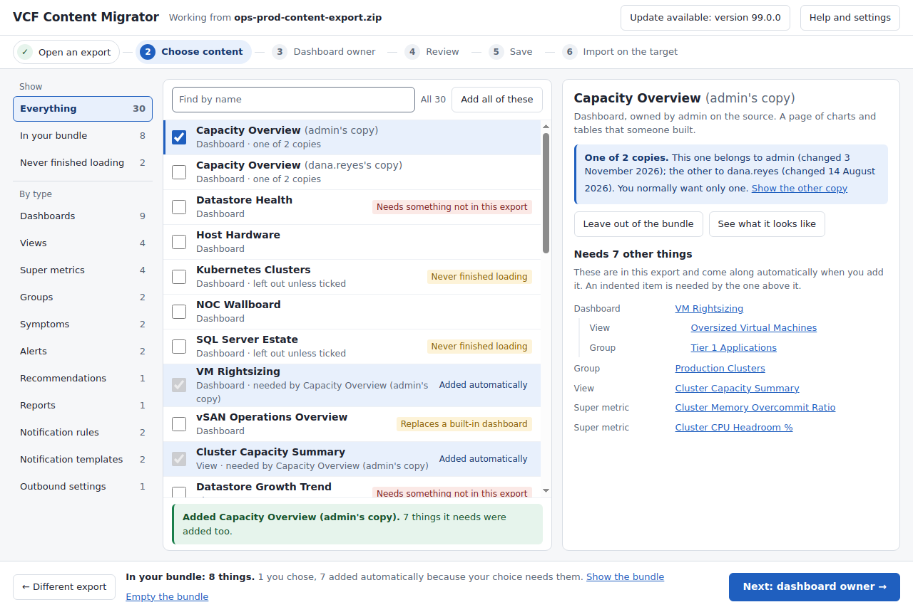

# VCF Content Migrator

[](https://github.com/sentania-labs/vcf-cf-migrator/releases/latest)
[](LICENSE)

Move selected custom content between VCF Operations instances. Open a content
export, preview what is in it, and choose what to keep. The tool adds the
available dependencies and writes a smaller ZIP for you to import on the target.

It runs on your workstation. The ZIP workflow needs no instance credentials or
connection to either Operations instance. Previews use sample values, not live
monitoring data.

> This README describes the current source. The latest packaged release is
> available below; its interface may differ until the next release.

## Download and open

Download the file for your operating system from the
[latest release](https://github.com/sentania-labs/vcf-cf-migrator/releases/latest).
Choose the archive for your computer and extract it:

| Your computer | Download |
| --- | --- |
| Mac with Apple silicon (M-series chip) | `vcfcf-migrator-macos-arm64-app.zip` |
| Linux x86-64 | `vcfcf-migrator-linux.tar.gz` |
| Windows x86-64 | `vcfcf-migrator-windows.zip` |

On a Mac, extract the archive, drag **VCF Content Migrator.app** to **Applications**, and open it.
The app opens its own window without a Terminal window. Mac app downloads are
signed and notarized, with the notarization ticket attached to the app.

On Windows, extract and double-click the Authenticode-signed `vcfcf-migrator.exe`.
On Linux, extract the archive, open a terminal in the extracted folder, and run:

```sh
./vcfcf-migrator
```

If the executable permission was lost when extracting, run
`chmod +x vcfcf-migrator` first. Keep the terminal open while using the Linux
app. All three platforms open a native window; the application does not start
a local web server.

Linux requires a graphical desktop and Qt's system libraries. The
[Ubuntu 24.04 package list](packaging/linux-runtime.txt) names the required
runtime packages; other distributions use different package names. The
command-line tools also work without a graphical session.

If your computer blocks the download, follow your organization's software
approval process. Include the release version and the exact message when
reporting a startup problem.

When the app opens, it checks GitHub for a newer stable release in the
background. If one is available, an **Update available** button appears at the
top of the window and opens the release page in your default browser. You
choose whether to download and install it. If you are offline or already up to
date, no button appears and you can keep working. The check sends no export
content or Operations credentials. Command-line commands do not check for
updates.

## Create a migration bundle

The window walks six steps, shown across the top the whole time. Each screen
asks one thing, and the button at the bottom right is always the next step.
Steps you have finished stay clickable, so you can go back.



1. **Open an export.** In VCF Operations on the source, go to **Administration >
   Content > Export**, tick what you want to move and the option to include what
   it depends on, and save the ZIP. If Operations asks for a password, keep it
   for the target import; the migrator does not need it. In the app, choose
   **Choose the export file…** (the file window opens in Downloads), or drop the
   ZIP on the window. A file that is damaged, is not an export, has lost its
   dashboards or has nothing in it is refused with what happened and what to do,
   and whatever you already had open stays open.
2. **Choose content.** Pick a type on the left or type part of a name in **Find
   by name**; the list narrows as you type. Click a name to see what it is, what
   it needs and what uses it, and **See what it looks like** for a picture. Tick
   what you want. Anything it needs is added for you and marked **Added
   automatically** with the choice that needs it. **Add all of these** adds
   everything shown that needs no decision from you.
3. **Dashboard owner.** Every dashboard belongs to a user. Choose **The built-in
   admin user** (the default, and the safest: that user exists on every target)
   or **The same user as on the source**, which keeps sharing as it is but may
   fail if one of those users is not on the target. A table shows what each
   choice does to every dashboard. If you ticked two owners' copies of the same
   dashboard, you are asked which to keep first.
4. **Review.** **Decide before saving** lists anything that cannot be put right
   after import: a dashboard the source never finished loading, one that would
   replace a built-in dashboard, or something that needs a thing the export does
   not hold. Each has a recommended answer (leave it out) and a way to keep it
   in. **Good to know** lists what needs no answer. Saving is off until
   everything under **Decide before saving** is answered.
5. **Save.** The bundle goes to your Downloads folder unless you choose
   **Change name or folder…**. A report and a checklist are saved beside it, and
   both can be read in the app. The migrator saves the bundle; it does not
   import it.
6. **Import on the target.** The last screen is the checklist for this bundle,
   one task at a time with the menus to click: import the file, switch on the
   super metrics, check group policies, share again where sharing was not
   carried. Tick tasks off as you go; the saved checklist file has the same
   list for later or for someone else.


The preview helps you recognize content before moving it. It shows the
export's own titles, layout and columns, with invented values. It cannot
confirm that the target has the adapters or resources a dashboard needs.

### When something the bundle needs is not in the export

A content export never carries some of the definitions that come with VCF
Operations itself or with a management pack, and nothing in an export says
which they are. So a missing dependency is refused by default, and the window
lets you answer for it: at **Review**, either leave the thing out (recommended),
open an export that has what is missing, or choose **I have checked this already
exists on the target. Keep it in anyway**. That answer is written in the report,
and the checklist gains a task to confirm it on the target after the import.
The command line has no such override: `build` refuses a selection with a
missing dependency.

## Get the export from VCF Operations for me

Choose **Sign in and download…** on the first screen. Enter the address of the
source, your user name and password, and make up a password for the export
(typed twice). **This account is** starts as a local account and offers the
sign-in choices the server returns. This is a user name and password sign-in,
not browser SSO.

**Test the sign-in** checks the address, user name and password without
starting an export. If the server uses a certificate your computer does not
recognise, the test says so and offers two ways on: **Use my company certificate
file…** (the safe one) or **Connect without checking**, which cannot prove it is
the real server.

**Sign in and download** shows four stages and can be cancelled. Operations
exports the supported custom content; when the download finishes you choose
content as usual. Keep the export password: the target asks for it at import,
and it must meet the source instance's password requirements.

Your user name and passwords are used once and never saved. The downloaded
export is held in a private temporary folder until you replace it or close the
app, so save your bundle before closing. After an abnormal shutdown, temporary
files may remain on the workstation.

Do not run another content export with the same account while this is running.
The Operations API serves the account's latest export. The migrator checks the
job identity before and after downloading, but cannot fully rule out a
competing export started at the same time. If a download fails, times out or is
cancelled after the source began preparing an export, check the source export
job before trying again. Whatever you had open stays open when a replacement
cannot be loaded. When you do switch to another export, your choices are ticked
again in it wherever the same things exist, and the app says how many were
found.

## What carries across

Supported content includes dashboards, views, super metrics, custom groups,
symptoms, alert definitions, recommendations, reports, notification rules,
notification templates, and outbound settings.

Selected content documents are copied unchanged, except that colliding local
resource tokens are rewritten when dashboards from multiple owners are merged.
Encrypted settings stay encrypted, and the original export remains your source
copy. Dashboard ownership maps to the built-in `admin` user on the target by
default; the **Dashboard owner** step can keep the source owners and their
directory sharing instead. Those users and directories must exist on the target
or their dashboards are skipped. By default, sharing with company-directory
groups is not carried and has to be set up again; the checklist says for which
dashboards. From the command line, `--target-owner USER` gives every dashboard
to one named user and `--keep-directory-ownership` keeps the source owners; the
window does not offer the named-user choice. If the same dashboard is chosen
under more than one owner, or the owners' localization files cannot be safely
combined, the owner step asks before anything is saved.

Three files are saved together: the bundle, `<name>-report.txt` and
`<name>-checklist.txt`. The report says what is inside, what was added and why,
who will own the dashboards, what was checked and what you chose to keep in;
its last section is the technical detail support may ask for. The command line
writes the same checklist beside its bundle.

Policies are not included. The checklist tells you which super metrics to
switch on and which groups had a policy of their own on the source, with the
policy's name where the export records it. The migrator does not verify the
target.

Linked dashboards are included automatically, including their dependencies.
Missing navigation targets and orphan widget links are reported; they do not
block when the export supports an inference that the target is already absent
on the source. After import, check links and widget data on the target.

## If something goes wrong

- **Missing dependencies:** export the required content from the source too, or
  leave out what depends on it. If you have checked that the target already has
  it, the Review step lets you keep the item in and records that you did.
- **Unexpected inventory count:** do not assume a manifest total equals the
  selectable inventory. One reported dashboard-count discrepancy remains
  unresolved in [#37](https://github.com/sentania-labs/vcf-cf-migrator/issues/37).
- **Empty widgets after import:** allow Operations time to finish processing,
  then check the target's adapters, resources, and widget configuration.
- **Slow loading or selection:** let the current action finish before trying
  again. Include the export size and the operation you were performing in a
  problem report.

In **Help and settings**, choose **Save a support report (diagnostics)**. It is
saved straight to your Downloads folder under a dated name; attach that file to
an [issue](https://github.com/sentania-labs/vcf-cf-migrator/issues) (**Report a
problem** opens that page). Include what you tried and what happened.

The support report keeps counts, timings and operation results while replacing
paths, account details, machine details and content identifiers with anonymous
labels. **A log file is private, not an anonymized report.** Do not attach one,
a source export, or screenshots containing private content to a public issue.
Previously saved reports are not changed by an upgrade.

**Help and settings** also has the light or dark appearance (light is the
default; the choice is saved for the next launch), a tick box for keeping a log
file, your version, and **What the words mean**.

## Command-line use

Inspection, tree/JSON output, selection-file input and `corpus-check` are
command-line tools. They are not controls in the desktop app. The saved
`corpus_dir` setting, `VCFCF_MIGRATOR_CORPUS` environment variable and `--corpus`
override continue to work. Connecting to a live Operations source is GUI-only.

On Mac, move the app to Applications first, then install its command-line
launcher from Terminal:

```sh
"/Applications/VCF Content Migrator.app/Contents/MacOS/vcfcf-migrator" install-cli
```

This creates a symlink in `/usr/local/bin` when writable, otherwise in
`~/.local/bin`. If the command reports that directory is not on your PATH, add
it to your shell's PATH. Keep the app in Applications; moving or removing it
breaks the link. The launcher can also be run directly at the path above.

The same tools are available from a terminal. These examples assume the
executable is named `vcfcf-migrator` and is on your PATH; otherwise use its full
path or downloaded filename.

```sh
vcfcf-migrator ui source-export.zip
vcfcf-migrator inspect source-export.zip
vcfcf-migrator tree source-export.zip
vcfcf-migrator preview source-export.zip 'Dashboard name' --out preview.html
vcfcf-migrator build source-export.zip --select selection.txt --out migration.zip
```

In `selection.txt`, put one object name or identifier on each line. Blank lines
and lines starting with `#` are ignored. Use an identifier when names are not
unique. `vcfcf-migrator build --help` lists the build options.

A dashboard that VCF Operations never finished loading is marked in the desktop
window, `inspect` and `tree`, with what it was waiting on. Its references are
unknown, so it is left out of **Add all of these** and `build --select-all`;
ticking it or naming it in a selection still includes it, and the window asks
you to confirm at Review. An export that says it holds dashboards but does not carry them is
refused: take the export again from the source.

For Python users, the release also includes a wheel. Install it with
`python -m pip install /path/to/the-downloaded.whl` using Python 3.9 or newer.
Installation downloads dependencies; working with local exports afterward
needs no instance connection.

Built on the [VCF Content Factory](https://github.com/sentania-labs/vcf-content-factory)
core library. Development and design notes are in [docs](docs/README.md).
