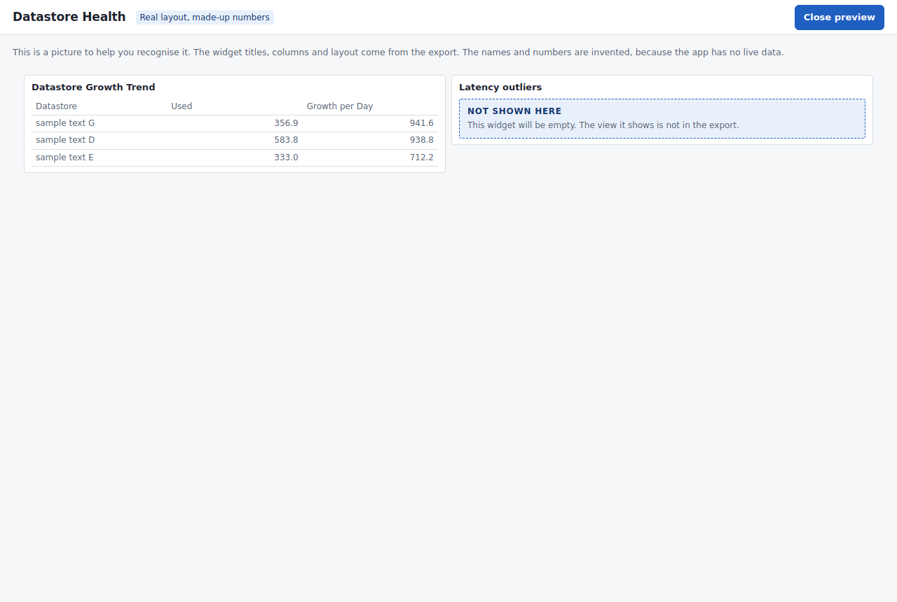

# VCF Content Migrator

[](https://github.com/sentania-labs/vcf-cf-migrator/releases/latest)
[](LICENSE)

Move selected custom content between VCF Operations instances. Open a content
export, preview what is in it, and choose what to keep. The tool adds the
available dependencies and writes a smaller ZIP for you to import on the target.

It runs on your workstation. The ZIP workflow needs no instance credentials or
connection to either Operations instance. Previews use sample values, not live
monitoring data.

> This README describes the current source. The latest packaged release is
> available below; its interface may differ until the next release.

## Download and open

Download the file for your operating system from the
[latest release](https://github.com/sentania-labs/vcf-cf-migrator/releases/latest).
Choose the archive for your computer and extract it:

| Your computer | Download |
| --- | --- |
| Mac with Apple silicon (M-series chip) | `vcfcf-migrator-macos-arm64-app.zip` |
| Mac with an Intel processor | `vcfcf-migrator-macos-x86_64-app.zip` |
| Linux x86-64 | `vcfcf-migrator-linux.tar.gz` |
| Windows x86-64 | `vcfcf-migrator-windows.zip` |

On a Mac, **Apple menu > About This Mac** shows the chip or processor. Extract
the archive, drag **VCF Content Migrator.app** to **Applications**, and open it.
The app opens its own window without a Terminal window. Mac app downloads are
signed and notarized, with the notarization ticket attached to the app.

On Windows, extract and double-click the Authenticode-signed `vcfcf-migrator.exe`.
On Linux, extract the archive, open a terminal in the extracted folder, and run:

```sh
./vcfcf-migrator
```

If the executable permission was lost when extracting, run
`chmod +x vcfcf-migrator` first. Keep the terminal open while using the Linux
app. All three platforms open a native window; the application does not start
a local web server.

Linux requires a graphical desktop and Qt's system libraries. The
[Ubuntu 24.04 package list](packaging/linux-runtime.txt) names the required
runtime packages; other distributions use different package names. The
command-line tools also work without a graphical session.

If your computer blocks the download, follow your organization's software
approval process. Include the release version and the exact message when
reporting a startup problem.

When the app opens, it checks GitHub for a newer stable release in the
background. If one is available, a small link beside the current version opens
the release page in your default browser. You choose whether to download and
install it. If you are offline or already up to date, no notice appears and
you can keep working. The check sends no export content or Operations
credentials. Command-line commands do not check for updates.

## Create a migration bundle

1. **Export from the source.** In VCF Operations, go to **Administration >
   Content > Export**, choose the content to export, and save the ZIP. Include
   the dependencies of the objects you intend to move. If Operations asks for
   an encryption password, keep it for the target import. The migrator does not
   need that password.
2. **Open the ZIP.** Choose **Open an export zip**, then **Browse**, or enter the file's
   local path and choose **Open export**.
3. **Review and select.** Choose a content type and search by name. Click an
   object to see its preview, dependencies, and details. **Select shown** adds
   the filtered results; **Select all** includes the whole readable inventory.
   Required objects are added automatically. Removing an object you selected
   keeps it included if another selected object still needs it.
4. **Review the bundle.** Choose **Review bundle** to check your selections and the
   dependencies they bring along. Resolve blocking references by using a more
   complete source export or removing the affected selections. Missing views and
   dashboards are reported as possibly already missing on the source when the
   export contains that content type; this is an offline inference. Check the
   listed widget objects and adapter kinds on the target before import. A missing
   object or kind can leave a dashboard loading.
5. **Build and import.** The migrator builds the bundle but does not import
   it. Use **Save As…** to choose a ZIP destination, or edit the path, then **Build bundle**. The app confirms the full destination and offers **Show in folder** where supported. Use the target instance's
   content import. Supply the original export password if requested. Open the
   imported objects on the target and check that their widgets, data sources,
   and links work.



The preview helps you recognize content before moving it. It preserves the
export's names, layout, columns, and metric keys, but its values are invented.
It cannot confirm that the target has the adapters or resources a dashboard
needs.

## Connect directly to Operations

Choose **Connect to VCF Operations** on the start page (or **Change source**
after loading content). Enter the HTTPS server URL, username and login password.
**Login source** starts at **Local** and offers the sources returned by the server;
you can also type a directory or SSO source name. Discovery uses your connection
security settings. A lookup failure does not prevent manual entry. This is a
username/password sign-in, not browser SSO.

Certificate verification is on by default. Use **Browse…** beside **Trusted CA
certificate bundle (PEM, optional)** for a private CA. **Ignore SSL validation**
disables verification and the CA field while retaining its path. The warning on
the form explains that the server's identity will not be verified.

**Test connection** checks the URL, TLS and credentials without starting an
export. Enter a separate **Export encryption password** when ready to download.

Choose **Connect and load**. Operations exports the supported custom content;
when the download finishes, select and build your bundle as usual. Keep the
export encryption password for the target import. It must meet the source
instance's password requirements.

Credentials are not saved. The downloaded export is held in a private temporary
folder until you replace it or close the app. Save your migration bundle before
closing. After an abnormal shutdown, temporary files may remain on the workstation.

Do not run another content export with the same account while connecting. The
Operations API serves the account's latest export. The migrator checks the job
identity before and after downloading, but cannot fully rule out a competing
export started at the same time. If a connection fails or times out, check the
source export job before trying again. Your existing inventory and selection
remain available when the replacement cannot be loaded. A successfully loaded replacement asks for confirmation before discarding your current selection.

## What carries across

Supported content includes dashboards, views, super metrics, custom groups,
symptoms, alert definitions, recommendations, reports, notification rules,
notification templates, and outbound settings.

Selected content documents are copied unchanged, except that colliding local
resource tokens are rewritten when dashboards from multiple owners are merged.
Encrypted settings stay encrypted, and the original export remains your source
copy. Dashboard ownership maps to local `admin` on the target by default; you
can choose another target user or keep source owners and directory sharing in
Review bundle. With the CLI, use `--target-owner USER` or
`--keep-directory-ownership`. Other users and source directories must exist on
the target or their dashboards will be skipped. By default, directory-group
sharing is removed and must be set again there. If the same dashboard ID is
selected under more than one owner, the build is refused until you choose one
copy or keep source owners. The same applies when the owners' localization
files cannot be safely combined; Review bundle says so before you build. The build report identifies any
rewritten tokens and lists the target objects and adapter kinds to check. The
desktop app also saves it beside the ZIP as `<name>-build-report.txt`.

Policies are not included. When the bundle contains super metrics or custom
groups, the build writes a post-import checklist beside the ZIP. Use it to enable
super metrics and check group policy assignments on the target. The report lists
source policy information where available. Check each world object's adapter has
at least one collecting instance. The migrator does not verify the target.

Linked dashboards are included automatically, including their dependencies.
Missing navigation targets and orphan widget links are reported; they do not
block when the export supports an inference that the target is already absent
on the source. After import, check links and widget data on the target.

## If something goes wrong

- **Missing dependencies:** export the required content from the source, or
  remove the selections that depend on it. A target might already have an object,
  but the offline tool cannot verify that.
- **Unexpected inventory count:** do not assume a manifest total equals the
  selectable inventory. One reported dashboard-count discrepancy remains
  unresolved in [#37](https://github.com/sentania-labs/vcf-cf-migrator/issues/37).
- **Empty widgets after import:** allow Operations time to finish processing,
  then check the target's adapters, resources, and widget configuration.
- **Slow loading or selection:** let the current action finish before trying
  again. Include the export size and the operation you were performing in a
  problem report.

In **Help & diagnostics**, choose **Save diagnostics…**, select a destination in the native save dialog, and attach
that file to an [issue](https://github.com/sentania-labs/vcf-cf-migrator/issues).
Include the application version, what you tried, and what happened.

Shared diagnostics retain counts, timings, and operation results while
replacing paths, account details, machine details, and content identifiers with
anonymous labels. **Local file logs are private, not anonymized diagnostics.**
Do not attach them, source exports, or screenshots containing private content
to a public issue. Previously saved reports are not changed by an upgrade.

Appearance is under **Help & diagnostics > Settings**. Light is the default;
your light/dark choice is saved for the next launch. Local log settings are in a
separate disclosure beneath appearance.

## Command-line use

Inspection, tree/JSON output, selection-file input and `corpus-check` are
command-line tools. They are not controls in the desktop app. The saved
`corpus_dir` setting, `VCFCF_MIGRATOR_CORPUS` environment variable and `--corpus`
override continue to work. Connecting to a live Operations source is GUI-only.

On Mac, move the app to Applications first, then install its command-line
launcher from Terminal:

```sh
"/Applications/VCF Content Migrator.app/Contents/MacOS/vcfcf-migrator" install-cli
```

This creates a symlink in `/usr/local/bin` when writable, otherwise in
`~/.local/bin`. If the command reports that directory is not on your PATH, add
it to your shell's PATH. Keep the app in Applications; moving or removing it
breaks the link. The launcher can also be run directly at the path above.

The same tools are available from a terminal. These examples assume the
executable is named `vcfcf-migrator` and is on your PATH; otherwise use its full
path or downloaded filename.

```sh
vcfcf-migrator ui source-export.zip
vcfcf-migrator inspect source-export.zip
vcfcf-migrator tree source-export.zip
vcfcf-migrator preview source-export.zip 'Dashboard name' --out preview.html
vcfcf-migrator build source-export.zip --select selection.txt --out migration.zip
```

In `selection.txt`, put one object name or identifier on each line. Blank lines
and lines starting with `#` are ignored. Use an identifier when names are not
unique. `vcfcf-migrator build --help` lists the build options.

For Python users, the release also includes a wheel. Install it with
`python -m pip install /path/to/the-downloaded.whl` using Python 3.9 or newer.
Installation downloads dependencies; working with local exports afterward
needs no instance connection.

Built on the [VCF Content Factory](https://github.com/sentania-labs/vcf-content-factory)
core library. Development and design notes are in [docs](docs/README.md).
